# CADimago — 3D CAD & Augmented Reality Web Viewer

CADimago is a specialized web platform that connects physical engineering drawings to interactive 3D WebGL models and Augmented Reality (WebAR). By scanning a QR code printed directly on a CAD blueprint or manufacturing drawing, engineers, clients, and fabricators can instantly inspect assemblies, verify spatial scales, and project 3D models into physical workspaces.

---

## The Workflow

```mermaid
flowchart LR
    A["Autodesk Inventor / CAD Plugin"] -->|"Export GLB (X-Plugin-Key)"| B["CADimago Server & Cloudflare R2"]
    B -->|"Generate QR Code"| C["Physical Engineering Drawing"]
    C -->|"Scan QR in Field"| D["Vintage Editorial Landing Page"]
    D -->|"OPEN 3D VIEWER"| E["Interactive 3D WebGL Canvas"]
    E -->|"VIEW IN AR"| F["Real-World WebAR (iOS / Android)"]
```



1. **CAD Plugin Export**: The Autodesk Inventor CADimago add-in exports the 3D assembly (`.glb`) directly to Cloudflare R2 via `/api/upload` using a secure plugin token.
2. **Physical Drawing Stamp**: A unique QR code (`/viewer?code=INV-XXXX-XXX`) is placed onto the title block of the 2D engineering drawing.
3. **Field QR Scan**: Workshop technicians, quality inspectors, or clients scan the QR code with any mobile device or tablet camera.
4. **Editorial Interstitial Landing**: Displays the drawing archive identity, geometric inspection notices, and a seamless 19th-century industrial woodcut lithograph.
5. **Interactive 3D & WebAR**: Launches the WebGL canvas to rotate, zoom, switch between perspective and orthographic drafting modes, or project the assembly 1:1 onto the factory floor via Augmented Reality.

---

## Key Features

### 1. Vintage Engineering & Editorial Blueprint Aesthetic
- **Parchment & Cobalt Palette**: Built with an antique parchment background (`#FAF6EE`) and deep cobalt blue ink (`#16335C`), eliminating boxed modern cards in favor of an unboxed technical drawing sheet.
- **ANSI / ASME Typography**: Styled throughout in **JetBrains Mono** with ALL-CAPS technical lettering conforming to engineering drawing standards (ANSI/ASME Y14.2M and ISO 3098).
- **Seamless Lithograph Artwork**: High-detail transparent copperplate engraving illustrating 19th-century Victorian engineers inspecting working blueprints beneath arched steel trusses and machinery.

### 2. Interactive 3D WebGL Inspection
- **Physically-Based Rendering (PBR)**: Powered by Google `<model-viewer>` with studio environment lighting, neutral tone mapping, and soft ground contact shadows.
- **Camera Controls**: Smooth inertial rotation, pinch-to-zoom, pan gestures, and one-tap view reset.
- **Continuous Auto-Rotation**: Automatic turntable rotation for hands-free presentations.

### 3. Orthographic vs. Perspective Projection Modes
- **Perspective Mode**: Natural eye view for spatial inspection and aesthetic comprehension.
- **Orthographic Mode**: True parallel projection with fixed 12° field of view, matching 2D engineering blueprints and isometric drafting conventions without perspective distortion.

### 4. Inventor-Style 3D ViewCube
- **Synchronized 3D Orientation**: A custom 3D orientation cube that tracks the camera orientation in real time.
- **Preset Face Alignment**: One-click snapping to standard orthographic views: `FRONT`, `BACK`, `LEFT`, `RIGHT`, `TOP`, `BOTTOM`.
- **Isometric Home**: Dedicated top-left home button to return to the standard isometric axonometric projection.

### 5. WebAR (Augmented Reality)
- **Zero App Installation**: Launches directly in mobile browsers using native OS engines.
- **Android Support**: WebXR Device API and Google Scene Viewer.
- **iOS Support**: Apple AR Quick Look for iPhone and iPad devices.
- **1:1 Real-World Scale**: Models project in calibrated physical dimensions for fit and clearance verification.

### 6. Administration & Catalog Management (`/admin`)
- **Secure Authentication**: Server-side HMAC signed session cookies with encrypted verification.
- **Model Catalog**: Real-time listing of uploaded GLB models in Cloudflare R2 with file size, upload date, download proxy, and deletion.
- **Access & Scan Analytics**: Records QR code field scans and access frequency stored in Vercel Blob / LibSQL database.

---

## Tech Stack

| Layer | Technology |
| :--- | :--- |
| **Framework** | [Next.js 16](https://nextjs.org/) (App Router, Turbopack compiler) |
| **3D & WebAR Engine** | Google [`<model-viewer>`](https://modelviewer.dev/) (Three.js WebGL/WebXR wrapper) |
| **Styling & Design** | [Tailwind CSS v4](https://tailwindcss.com/) + `@tailwindcss/postcss` |
| **Typography** | [JetBrains Mono](https://www.jetbrains.com/lp/mono/) via `next/font/google` |
| **Cloud Storage** | [Cloudflare R2](https://www.cloudflare.com/developer-platform/r2/) (S3-compatible, proxy delivery) |
| **Database & Analytics** | [Turso](https://turso.tech/) (LibSQL SQLite) & [Vercel Blob](https://vercel.com/docs/storage/vercel-blob) |
| **Icons** | [Lucide React](https://lucide.dev/) |

---

## Project Structure

```text
├── public/
│   ├── images/
│   │   ├── engraving-editorial-transparent.png # Transparent cobalt linework artwork
│   │   └── vintage-engraving-factory.jpg      # Industrial heritage reference
│   └── models/
│       └── sample-cube.glb                    # Built-in lightweight test geometry
├── src/
│   ├── app/
│   │   ├── admin/                             # Admin dashboard & session login
│   │   ├── api/
│   │   │   ├── admin/                         # Session, visits, and blob API
│   │   │   ├── cad/                           # R2 proxy download and catalog
│   │   │   ├── model/                         # Public model URL resolver
│   │   │   └── upload/                        # Plugin upload & presign endpoints
│   │   ├── viewer/
│   │   │   └── page.js                        # 3D canvas and routing lifecycle
│   │   ├── globals.css                        # Design tokens, fonts, and base rules
│   │   ├── layout.js                          # Root HTML and Google Fonts loader
│   │   └── page.js                            # Client portal search & manual entry
│   ├── components/
│   │   ├── ViewCube.jsx                       # 3D drafting orientation cube
│   │   └── VintageLanding.jsx                 # Editorial vintage landing page
│   └── lib/
│       ├── auth.js                            # Admin HMAC password verification
│       ├── db.js                              # Database connection utilities
│       ├── plugin-auth.js                     # X-Plugin-Key validation
│       └── r2Storage.js                       # Cloudflare R2 S3 client
└── scripts/                                   # Verification, test & capture scripts
```

---

## Environment Variables

Configure the following environment variables in your deployment environment or `.env.local`:

```bash
# Admin Dashboard Authentication
ADMIN_PASSWORD=your_secure_admin_password
ADMIN_SESSION_SECRET=a_random_32_character_string_for_hmac

# CAD / Inventor Plugin Upload Authentication
PLUGIN_UPLOAD_KEY=shared_secret_matching_plugin_config

# Cloudflare R2 (S3-Compatible Model Storage)
R2_ACCOUNT_ID=your_cloudflare_account_id
R2_ACCESS_KEY_ID=your_r2_access_key_id
R2_SECRET_ACCESS_KEY=your_r2_secret_access_key
R2_BUCKET_NAME=cadimago-models

# Database (Optional for visits & analytics)
TURSO_DATABASE_URL=libsql://your-database.turso.io
TURSO_AUTH_TOKEN=your_turso_auth_token
```

---

## Getting Started

### Prerequisites
- Node.js 18.18 or higher (Node 20+ recommended)
- npm, pnpm, or yarn

### Installation

1. Clone the repository:
   ```bash
   git clone https://github.com/ZayyanKarlsefni/AR-Model-Viewer.git
   cd AR-Model-Viewer
   ```

2. Install dependencies:
   ```bash
   npm install
   ```

3. Start the development server:
   ```bash
   npm run dev
   ```

4. Open [http://localhost:3000](http://localhost:3000) in your browser.

---

## URL Parameters & Routing

| Route | Purpose |
| :--- | :--- |
| `/viewer?code=INV-2026-001` | Displays the vintage editorial landing page for document `INV-2026-001`. Clicking **`OPEN 3D VIEWER`** loads the model. |
| `/viewer?code=INV-2026-001&direct=true` | Bypasses the landing card and mounts the 3D WebGL viewer immediately. |
| `/viewer?file=/models/sample-cube.glb&direct=true` | Loads a local or direct URL GLB asset directly into the viewer. |
| `/viewer?code=INV-2026-001&debug=true` | Enables the diagnostics console displaying internal load times, API statuses, and logs. |
| `/admin` | Access the model catalog and view scan visit analytics. |

---

## Quality & Verification

Before committing changes, execute the required test and lint suites:

```bash
# Code style and syntax verification
npm run lint

# Production Next.js Turbopack build compilation
npm run build
```

Both checks must pass cleanly with exit code `0`.

---

## License

This project is licensed under the MIT License.
